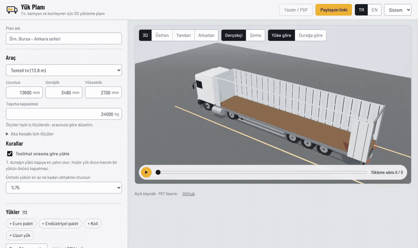
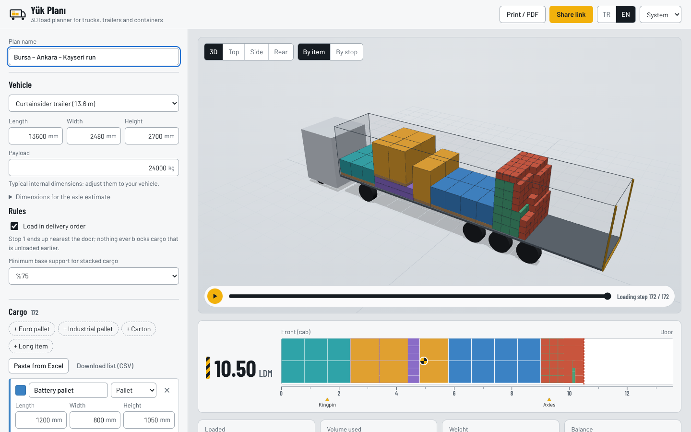
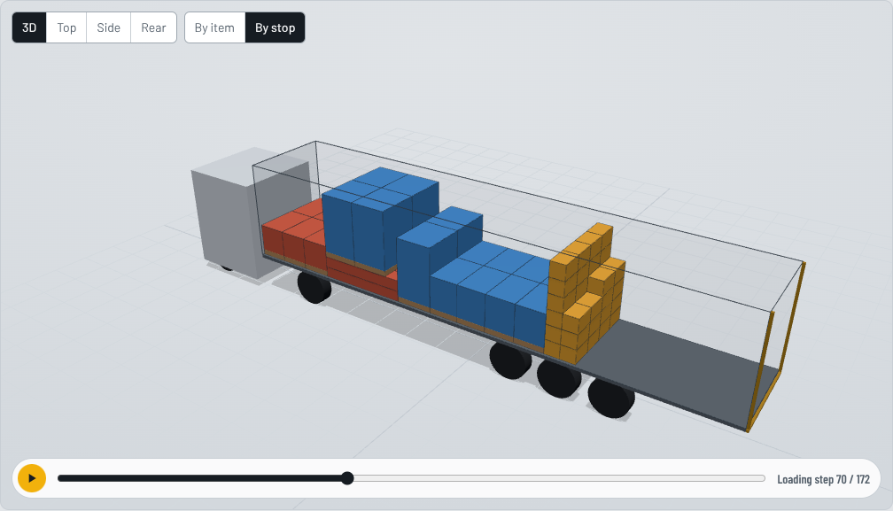
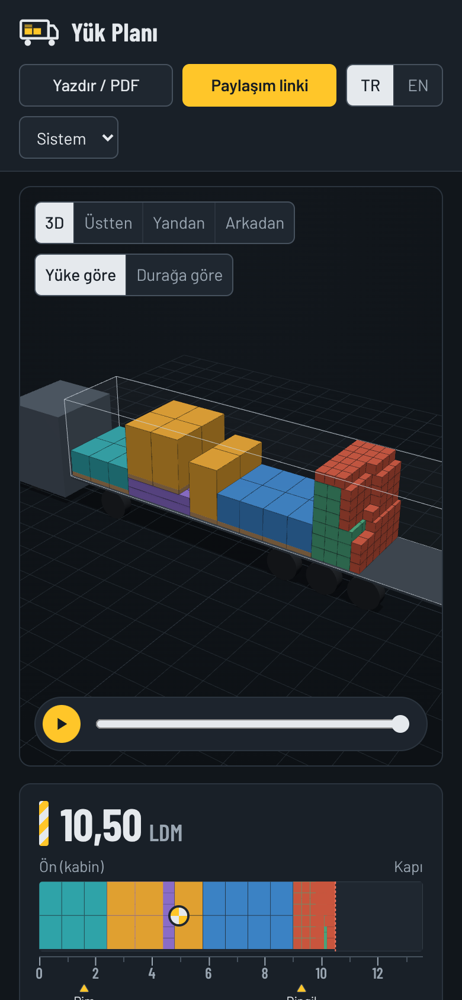

<p align="center">
  
</p>

<h1 align="center">Yük Planı</h1>

<p align="center">
  <strong>Plan how pallets and cartons fit into a truck, trailer or container, and see it in 3D before the forklift moves.</strong><br>
  Open-source load planner with stacking rules, delivery order, loading metres and weight balance. Runs in your browser.
</p>

<p align="center">
  <a href="https://harunnkcnn.github.io/yuk-plani/"><b>Live demo</b></a> ·
  <a href="README.tr.md">Türkçe</a> ·
  <a href="#features">Features</a> ·
  <a href="#how-the-planner-works">How it works</a> ·
  <a href="#run-it-yourself">Run it yourself</a>
</p>

<p align="center">
  <a href="https://github.com/harunnkcnn/yuk-plani/actions/workflows/ci.yml"></a>
  <a href="LICENSE"></a>
  
</p>

<p align="center">
  <a href="docs/assets/demo.mp4"></a>
</p>

## Why

On a loading dock, the plan usually lives in someone's head. Will the 13.6 m trailer take this order? Do the tyre pallets go before the batteries? Will the driver have to unload half the trailer at the first stop to reach the right pallet? The answers come from experience and a lot of re-stacking.

Good load-planning software exists, but it is paid and usually built for large shippers. Open-source options are thin: [Stack Solver](https://github.com/vladm7/stack-solver) is Windows-only and plans single pallets, with truck loading still on its roadmap; most others are prototypes.

Yük Planı is the free, browser-based version for everyday dispatch work:

- **Delivery order built in.** Cargo for later stops goes deeper, and nothing for a later stop ever ends up between earlier cargo and the door.
- **Speaks the dock's language.** Loading metres (LDM), Euro and industrial pallets, "can carry load on top", 90° turning, kingpin and axle load.
- **No account, no server.** Plans stay in your browser. Share one with a link; the plan travels inside the link itself.

## Features

| | |
|---|---|
| **Vehicles** | 13.6 m curtainsider and mega trailers, 8 m rigid truck, panel van, 20' DC, 40' DC and 40' HC containers, or any custom size and payload. |
| **Cargo templates** | Euro pallet (1200×800), industrial pallet (1200×1000), carton, long item. Pallets are drawn with their wooden base. |
| **Rules** | Upright only (90° turning optional per item), "can carry load on top" per item, adjustable minimum base support for stacked cargo, payload limit. |
| **Delivery order** | Give each item a stop number. Stop 1 ends up nearest the door; nothing for a later stop ever blocks it. |
| **3D view** | Orbit, zoom, 3D, top, side and rear presets, colour by item or by stop, hover for size, weight and position. |
| **Loading sequence** | Step or play through the plan in the order a forklift driver would load it. |
| **Loading metres** | The cargo floor drawn to scale as a ruler, with LDM, centre of gravity, kingpin and axles. |
| **Weight balance** | Centre of gravity along and across the body; for trailers, an estimated split between kingpin and axle group. |
| **Excel in, CSV out** | Paste rows straight from Excel or Google Sheets (Turkish or English headers, mm/cm/m, `1.200` and `1,2` both understood) or load a CSV. Export the list back. |
| **Driver's sheet** | Print or save as PDF: top and side views coloured by stop, loading sequence grouped into lines, tick boxes, signature line. |
| **Share links** | The whole plan is compressed into the link's `#fragment`, which browsers never send to a server. |
| **Turkish and English** | Full UI in both, light and dark themes, keyboard accessible, works on phones. |

<table>
  <tr>
    <td></td>
  </tr>
  <tr>
    <td align="center">A mixed three-stop load: 172 units, 10.50 LDM, all placed in about 0.1 s</td>
  </tr>
</table>

<p align="center">
  
  
</p>

## How the planner works

The planner places one unit at a time using the **extreme-point method** with wall building: each unit goes to the free corner furthest towards the front wall, then lowest, then leftmost. Units are sorted by stop (latest first), then by footprint, height and weight. Every placement must pass these rules:

1. Inside the cargo space and not overlapping anything.
2. Upright. A 90° turn on the floor is allowed only if the item allows it.
3. A unit above the floor rests at least the chosen share (default 75%) of its base on cargo whose top is exactly at its bottom, and all of that cargo must allow load on top.
4. Total weight stays within payload.
5. With delivery order on, no unit for a later stop sits between it and the door.

The whole plan runs three times with different orientation preferences (best fit across the width, turned, as given) and keeps the one that loads the most units in the shortest length. It runs in a Web Worker, so typing in the cargo list never freezes the 3D view.

3D packing is NP-hard, so the result is **good, not provably optimal**. Benchmarks from the test suite:

| Load | Result |
|---|---|
| Euro pallets, 13.6 m trailer | 34 (2 abreast), or 33 if turning is not allowed |
| Industrial pallets, 13.6 m trailer | 26 |
| Stackable Euro pallets 1.2 m high | 68 (two layers) |
| 600×400×400 cartons, 40' DC | 550, five layers of 110 |
| Mixed 3-stop sample, 172 units | all placed in about 0.1 s |

Every test plan is checked by an independent validator for bounds, overlap, support, stackability, payload and delivery order.

**Estimates, not legal checks.** The centre of gravity assumes each unit's weight sits at its centre. The kingpin/axle split treats the trailer as a beam on two supports, using editable positions (kingpin 1.6 m from the front wall, from the 12 m kingpin-to-rear limit in EU Directive 96/53/EC; axle group centre 9.3 m, a typical value). They exclude the vehicle's own weight. Always follow your vehicle's documents and local regulations.

## Run it yourself

Requirements: Node.js 22+.

```bash
git clone https://github.com/harunnkcnn/yuk-plani.git
cd yuk-plani
npm ci
npm run dev        # http://localhost:5173
npm test           # planner, rules, import, share links
npm run build      # static files in dist/
```

`dist/` is plain static files; host it anywhere. To serve under a sub-path, build with `VITE_BASE=/your-path/ npm run build`.

### Project layout

```
src/lib/pack.ts      planner (extreme points, rules, strategies)
src/lib/balance.ts   centre of gravity and kingpin/axle estimate
src/lib/table.ts     Excel/CSV import and export
src/lib/share.ts     plan ⇄ compressed link fragment
src/lib/presets.ts   vehicles, cargo templates, sample load
src/plan.worker.ts   runs the planner off the main thread
src/components/      3D view (three.js, loaded on demand), ruler, cargo list, print sheet
```

## Roadmap

- [ ] Multiple vehicles: split a large order across trucks automatically
- [ ] Weight-per-unit limits for stacking (e.g. max 500 kg on top)
- [ ] Mixed-carton pallet building (palletising)
- [ ] Load securing hints (gaps, straps, airbags)
- [ ] Installable offline app (PWA)

Ideas and real loads that plan badly are welcome as [issues](https://github.com/harunnkcnn/yuk-plani/issues). A share link reproduces a plan exactly.

## License and credits

[MIT](LICENSE) © Harun. Third-party components keep their own licenses; see [THIRD_PARTY_NOTICES](THIRD_PARTY_NOTICES.md). Vehicle dimensions are typical values; the sample load is fictional.
