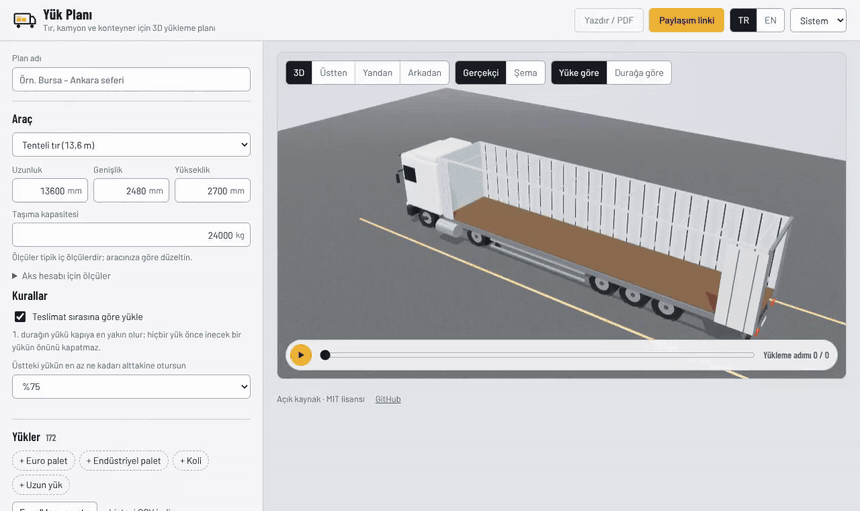
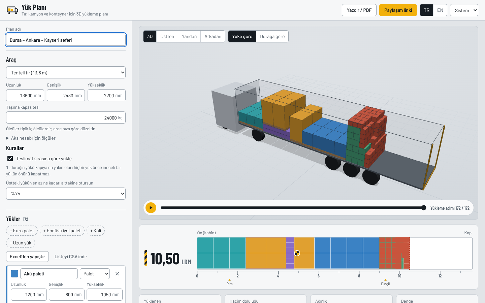
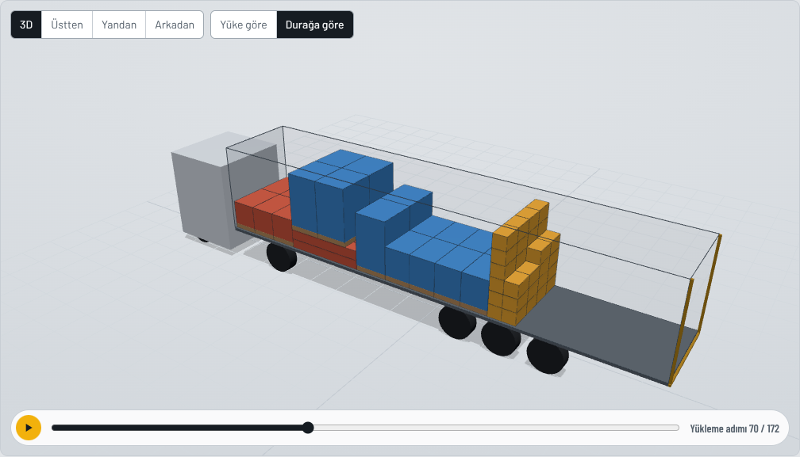
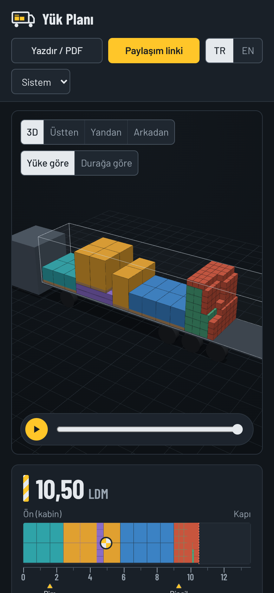

<p align="center">
  
</p>

<h1 align="center">Yük Planı</h1>

<p align="center">
  <strong>Paletlerin ve kolilerin tıra, kamyona ya da konteynere nasıl sığacağını planlayın; forklift kıpırdamadan 3D olarak görün.</strong><br>
  İstif kuralları, teslimat sırası, yükleme metresi ve ağırlık dengesiyle açık kaynak yük planlayıcı. Tarayıcıda çalışır.
</p>

<p align="center">
  <a href="https://harunnkcnn.github.io/yuk-plani/"><b>Canlı demo</b></a> ·
  <a href="README.md">English</a> ·
  <a href="#özellikler">Özellikler</a> ·
  <a href="#planlayıcı-nasıl-çalışır">Nasıl çalışır</a> ·
  <a href="#kendiniz-çalıştırın">Kendiniz çalıştırın</a>
</p>

<p align="center">
  <a href="https://github.com/harunnkcnn/yuk-plani/actions/workflows/ci.yml"></a>
  <a href="LICENSE"></a>
  
</p>

<p align="center">
  <a href="docs/assets/demo.mp4"></a>
</p>

## Neden

Sevkiyat rampasında yükleme planı genelde birinin kafasında olur. Bu sipariş 13,6 metrelik tıra sığar mı? Lastik paletleri akülerden önce mi girmeli? Şoför ilk durakta doğru palete ulaşmak için tırın yarısını boşaltmak zorunda kalır mı? Cevaplar tecrübeden ve bolca yeniden istiften gelir.

İyi yük planlama yazılımları var ama ücretliler ve çoğunlukla büyük gönderenler için yapılmışlar. Açık kaynak tarafı zayıf: [Stack Solver](https://github.com/vladm7/stack-solver) yalnızca Windows'ta çalışıyor ve tek palet planlıyor, tır yüklemesi hâlâ yapılacaklar listesinde; diğerlerinin çoğu prototip.

Yük Planı, günlük sevkiyat işi için ücretsiz ve tarayıcıda çalışan sürüm:

- **Teslimat sırası işin içinde.** Sonraki durakların yükü daha içeri girer; sonraki bir durağın yükü hiçbir zaman önce inecek yük ile kapı arasına girmez.
- **Rampanın dilini konuşur.** Yükleme metresi (LDM), Euro ve endüstriyel palet, "üstüne yük konabilir", 90° döndürme, şkemle pimi ve dingil yükü.
- **Hesap yok, sunucu yok.** Planlar tarayıcınızda kalır. Bir linkle paylaşın; plan linkin kendisinin içinde taşınır.

## Özellikler

| | |
|---|---|
| **Araçlar** | 13,6 m tenteli ve mega tır, 8 m kamyon, panelvan, 20' DC, 40' DC ve 40' HC konteyner ya da istediğiniz ölçü ve kapasite. |
| **Yük şablonları** | Euro palet (1200×800), endüstriyel palet (1200×1000), koli, uzun yük. Paletler ahşap tabanlarıyla çizilir. |
| **Kurallar** | Yalnızca dik (90° döndürme yük bazında isteğe bağlı), yük bazında "üstüne yük konabilir", istiflenen yük için ayarlanabilir en az taban desteği, taşıma kapasitesi sınırı. |
| **Teslimat sırası** | Her yüke bir durak numarası verin. 1. durak kapıya en yakın olur; sonraki bir durağın yükü hiçbir zaman önünü kapatmaz. |
| **3D görünüm** | Döndürme ve yakınlaştırma; 3D, üstten, yandan ve arkadan görünümler; yüke ya da durağa göre renk; üzerine gelince ölçü, ağırlık ve konum. |
| **Yükleme sırası** | Planı bir forkliftçinin yükleyeceği sırayla adım adım izleyin ya da oynatın. |
| **Yükleme metresi** | Kasa tabanı ölçekli bir cetvel olarak çizilir: LDM, ağırlık merkezi, şkemle pimi ve dingiller. |
| **Ağırlık dengesi** | Kasa boyunca ve enine ağırlık merkezi; tırlarda pim ile dingil grubu arasında tahmini yük dağılımı. |
| **Excel'den al, CSV ver** | Satırları doğrudan Excel ya da Google E-Tablolar'dan yapıştırın (Türkçe ya da İngilizce başlık, mm/cm/m, `1.200` ve `1,2` ikisi de anlaşılır) ya da CSV yükleyin. Listeyi geri dışa aktarın. |
| **Şoför formu** | Yazdırın ya da PDF kaydedin: durağa göre renklendirilmiş üstten ve yandan görünüm, satırlara gruplanmış yükleme sırası, onay kutuları, imza satırı. |
| **Paylaşım linki** | Planın tamamı linkin `#` kısmına sıkıştırılır; tarayıcılar bu kısmı hiçbir sunucuya göndermez. |
| **Türkçe ve İngilizce** | İki dilde tam arayüz, açık/koyu tema, klavyeyle kullanılabilir, telefonda çalışır. |

<table>
  <tr>
    <td></td>
  </tr>
  <tr>
    <td align="center">Üç duraklı karışık yük: 172 birim, 10,50 LDM, yaklaşık 0,1 saniyede yerleşti</td>
  </tr>
</table>

<p align="center">
  
  
</p>

## Planlayıcı nasıl çalışır

Planlayıcı birimleri tek tek **uç nokta (extreme point) yöntemiyle** ve duvar örer gibi yerleştirir: her birim, ön duvara en yakın, sonra en alçak, sonra en soldaki boş köşeye gider. Birimler önce durağa (en son durak önce), sonra taban alanına, yüksekliğe ve ağırlığa göre sıralanır. Her yerleşim şu kurallardan geçmek zorundadır:

1. Kasanın içinde olmalı ve hiçbir şeyle çakışmamalı.
2. Dik durmalı. Yerde 90° döndürmeye yalnızca yük izin veriyorsa izin verilir.
3. Yerde olmayan bir birimin tabanının en az seçilen kadarı (varsayılan %75) tam altındaki yüklere oturmalı ve o yüklerin hepsi üstüne yük konmasına izin vermeli.
4. Toplam ağırlık taşıma kapasitesini aşmamalı.
5. Teslimat sırası açıksa, sonraki bir durağın yükü bu birim ile kapı arasına girmemeli.

Plan, farklı yön tercihleriyle (enine en iyi oturan, döndürülmüş, verildiği gibi) üç kez çalıştırılır; en çok birimi en kısa boyda yükleyen sonuç seçilir. Hesap bir Web Worker'da yapılır, böylece yük listesine yazarken 3D görünüm donmaz.

3D yerleştirme NP-zor bir problemdir; sonuç **iyidir ama en iyi olduğu kanıtlanamaz**. Test setinden ölçümler:

| Yük | Sonuç |
|---|---|
| Euro palet, 13,6 m tır | 34 (ikili dizilim) ya da döndürme kapalıysa 33 |
| Endüstriyel palet, 13,6 m tır | 26 |
| İstiflenebilir 1,2 m Euro palet | 68 (iki kat) |
| 600×400×400 koli, 40' DC | 550 (110'luk beş kat) |
| Üç duraklı karışık örnek, 172 birim | hepsi yaklaşık 0,1 saniyede yerleşti |

Testlerdeki her plan; kasa sınırı, çakışma, destek, istiflenebilirlik, kapasite ve teslimat sırası için bağımsız bir doğrulayıcıdan geçer.

**Tahmindir, yasal kontrol değildir.** Ağırlık merkezi her birimin ağırlığının ortasında olduğunu varsayar. Pim/dingil dağılımı tırı iki mesnetli bir kiriş olarak hesaplar; konumlar düzenlenebilir. Pim için varsayılan ön duvardan 1,6 m'dir ve AB 96/53/EC yönergesindeki 12 m'lik pim-arka sınırından gelir. Dingil grubu ortası için varsayılan 9,3 m tipik bir değerdir. Aracın kendi ağırlığı hesaba katılmaz. Her zaman aracınızın belgelerine ve yerel mevzuata uyun.

## Kendiniz çalıştırın

Gereksinim: Node.js 22+.

```bash
git clone https://github.com/harunnkcnn/yuk-plani.git
cd yuk-plani
npm ci
npm run dev        # http://localhost:5173
npm test           # planlayıcı, kurallar, içe aktarma, paylaşım linkleri
npm run build      # statik dosyalar dist/ klasöründe
```

`dist/` düz statik dosyalardır; istediğiniz yerde barındırabilirsiniz. Alt dizinde yayınlamak için `VITE_BASE=/yolunuz/ npm run build`.

### Proje yapısı

```
src/lib/pack.ts      planlayıcı (uç noktalar, kurallar, stratejiler)
src/lib/balance.ts   ağırlık merkezi ve pim/dingil tahmini
src/lib/table.ts     Excel/CSV içe ve dışa aktarma
src/lib/share.ts     plan ⇄ sıkıştırılmış link
src/lib/presets.ts   araçlar, yük şablonları, örnek yük
src/plan.worker.ts   planlayıcıyı ana iş parçacığı dışında çalıştırır
src/components/      3D görünüm (three.js, gerektiğinde yüklenir), cetvel, yük listesi, yazdırma formu
```

## Yol haritası

- [ ] Birden fazla araç: büyük bir siparişi otomatik olarak araçlara bölme
- [ ] İstif için ağırlık sınırı (ör. üstüne en fazla 500 kg)
- [ ] Karışık koliden palet oluşturma (paletleme)
- [ ] Yük emniyeti ipuçları (boşluk, spanzet, hava yastığı)
- [ ] Çevrim dışı kurulabilir uygulama (PWA)

Fikirler ve kötü planlanan gerçek yükler [issue](https://github.com/harunnkcnn/yuk-plani/issues) olarak çok değerli. Paylaşım linki bir planı birebir yeniden üretir.

## Lisans ve teşekkür

[MIT](LICENSE) © Harun. Üçüncü taraf bileşenler kendi lisanslarını korur; bkz. [THIRD_PARTY_NOTICES](THIRD_PARTY_NOTICES.md). Araç ölçüleri tipik değerlerdir; örnek yük kurgusaldır.
